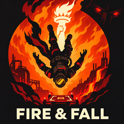
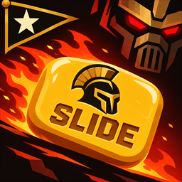
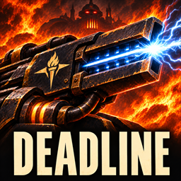

# HellForge Mods

Standalone mods for HellForge. Pick the ones you want. This catalog covers HellForge 0.5 beta on HELLDIVERS 2 build `25480438`.

## Main mods

| Cover | Mod | What it does |
| --- | --- | --- |
|  | [Fire & Fall Controls](fire-and-fall/README.md) | Set fire and fall damage protection independently from Off to 100%. |
|  | [HELLSLIDERS](hellsliders/README.md) | Adjustable crouch sliding with presets for slide speed, duration, and slopes. |
|  | [DEA(c)DLINE](weapons/deadline/README.md) | Overcharge protection for Railgun and Epoch, plus a compact impact blast for the Railgun. |
|  | First Person View | Upcoming first-person camera mod with a minimal editable HUD, toggleable throw guides, and an F6 switch back to third person. |

## [Weapon mods](weapons/README.md)

JAR-5 Dominator Bolt Blast, MG-206 Realistic, R-72 Censor, AR-32 Pacifier, SMG-32 Reprimand, LAS-58 Talon Impact Blast, and DEA(c)DLINE. The weapon page also lists the Mist, Double Nova, and Warrant test builds.

## Loader requirements

Fire & Fall Controls and HELLSLIDERS use [Bingus Shared Loader v20](https://github.com/CowboyBingus/BingusSharedLoader/releases/tag/v20) and [Mod Options Menu v1.0.1](https://github.com/CowboyBingus/ModOptionsMenu/releases/tag/v1.0.1). Fire & Fall also uses the editor included with HellForge.

The upcoming First Person View build uses a HellForge-specific package that combines [Chef Shared Loader 1.5.4](https://github.com/Th3chef/Chef-Shared-Loader/releases/tag/v1.5.4) and [Bingus Shared Loader v20](https://github.com/CowboyBingus/BingusSharedLoader/releases/tag/v20). These are the upstream project links. The standalone Chef download targets later Steam builds.

Install a HellForge release through **Mods → Add mods** and restart the session to apply it.

[All standalone downloads](https://github.com/RojoMojo666/HellForge-Mods/tree/main/downloads) · [Get HellForge](https://github.com/SkyeShade/HellForge/releases)
