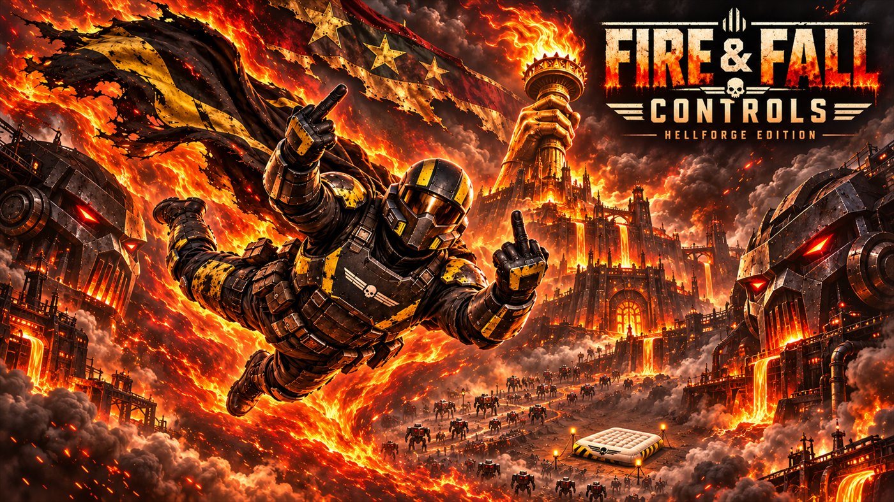

# Fire & Fall Controls

[Download 1.4.0 for HellForge](https://github.com/RojoMojo666/HellForge-Mods/raw/refs/heads/main/downloads/Fire-and-Fall-Controls-v1.4.0-HellForge-build25480438.zip)

Set your own fire and fall damage protection in the game menu. Both settings have **Off**, **25%**, **50%**, **75%**, and **100%** options. The two settings are independent, so you can have full fall protection and keep fire dangerous.

## In game

Open **Esc → Mods → Fire & Fall Controls**, choose both settings, and select **Apply**. A fresh spawn may be needed for the changes to take effect. The HellForge preset starts with both settings at 100%.

Hard landings can still concuss you with fall damage turned off.

**HellForge build 1.4.0.** Requires Bingus Shared Loader and Mod Options Menu.

[Back to HellForge Mods](../README.md)
