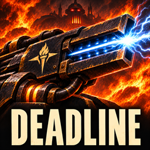
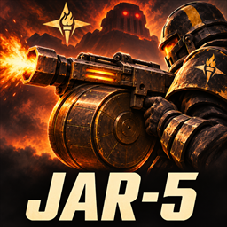
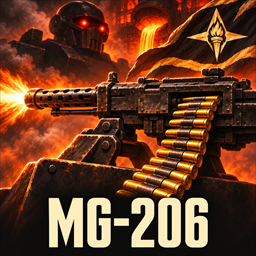
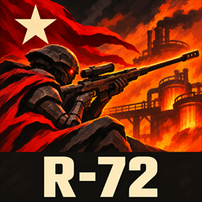
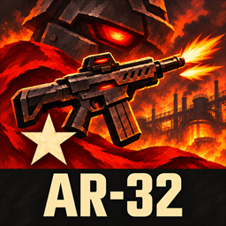
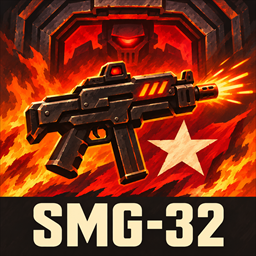
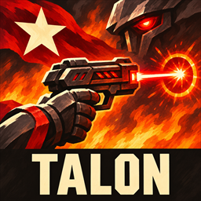

# Weapon mods

Pick the individual preset for the weapon you want to change. Penetration is listed as **direct / slight angle / large angle / extreme angle**.

| Cover | Mod | What it does | Download |
| --- | --- | --- | --- |
|  | [DEA(c)DLINE](deadline/README.md) | Protects the Railgun and Epoch from overcharge destruction and adds a 2 m Railgun impact blast. | [ZIP](https://github.com/RojoMojo666/HellForge-Mods/raw/refs/heads/main/downloads/DEADLINE-Railgun-Stock-Blast-Per-Player-v1.3.0-build25480438.zip) |
|  | [JAR-5 Dominator Bolt Blast](jar-5/README.md) | Gives the Dominator a 30-round drum, AP 4/4/4/2 direct hits, and the Bolt Pistol impact blast. | [ZIP](https://github.com/RojoMojo666/HellForge-Mods/raw/refs/heads/main/downloads/JAR-5-Dominator-Bolt-Blast-Per-Player-v0.2.2-HellForge-build25480438.zip) |
|  | MG-206 Realistic | Tunes recoil and spread, sets fire rates to 600, 750, and 900 RPM, and gives three spare magazines and three from resupply. | [ZIP](https://github.com/RojoMojo666/HellForge-Mods/raw/refs/heads/main/downloads/MG-206-Realistic-Per-Player-v1.0.0-HellForge-build25480438.zip) |
|  | R-72 Censor | Sets direct hits to 220 standard damage, 75 durable damage, and AP 4/4/3/2. | [ZIP](https://github.com/RojoMojo666/HellForge-Mods/raw/refs/heads/main/downloads/R-72-Censor-HellForge-v1.0.0-build25480438.zip) |
|  | AR-32 Pacifier | Gives it a 55-round magazine, 775 RPM automatic fire, a 1,200 RPM two-round burst, and 130 standard / 65 durable damage. | [ZIP](https://github.com/RojoMojo666/HellForge-Mods/raw/refs/heads/main/downloads/AR-32-Pacifier-HellForge-v1.0.0-build25480438.zip) |
|  | SMG-32 Reprimand | Gives it a 50-round magazine, 800 RPM automatic fire, a 1,300 RPM three-round burst, and AP 4/4/3/1. | [ZIP](https://github.com/RojoMojo666/HellForge-Mods/raw/refs/heads/main/downloads/SMG-32-Reprimand-HellForge-v1.0.0-build25480438.zip) |
|  | LAS-58 Talon Impact Blast | Fires the regular bolts immediately, adds a 1.5 m impact blast, and doubles heat capacity to 200. | [ZIP](https://github.com/RojoMojo666/HellForge-Mods/raw/refs/heads/main/downloads/LAS-58-Talon-Impact-Blast-Per-Player-1.1.0-HellForge-build25480438.zip) |

## Testing builds

| Mod | What it does |
| --- | --- |
| P-44 Mist | 40 rounds, 600 RPM auto, and a 900 RPM three-round burst. Requires the Scope of Authority backport. |
| Double Nova | Tunes the fire rate to 60 RPM and cooling to a two-second delay. Requires the Scope of Authority backport. |
| P-92L Warrant | A two-feed prototype with 12 rounds per feed. Switch between standard rounds and guided mini-WASP rounds. Guidance has only been configured for solo play. |

The testing builds still need gameplay validation on HellForge 0.5.

[Back to HellForge Mods](../README.md)
